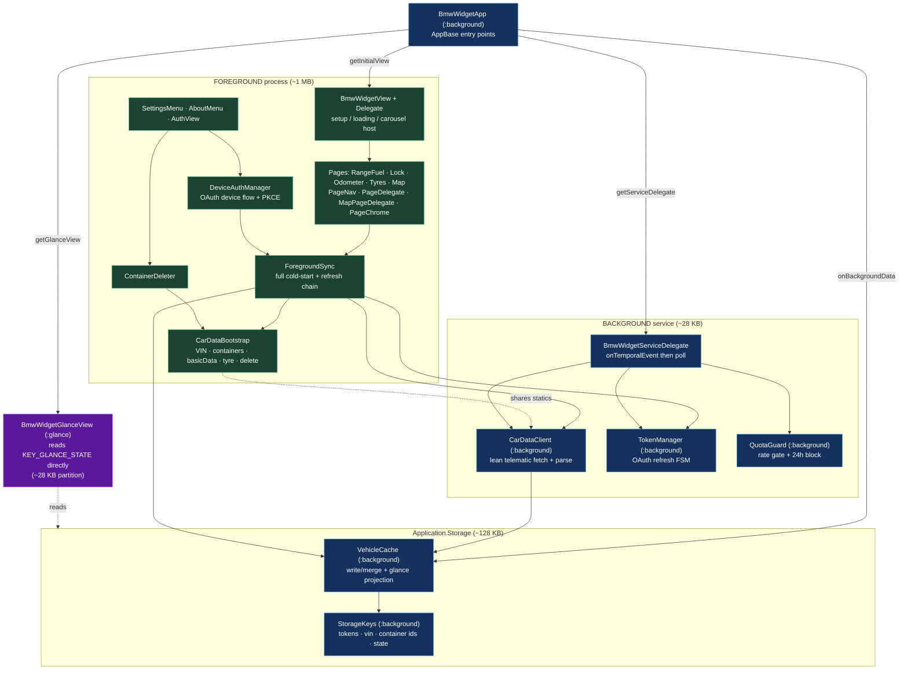
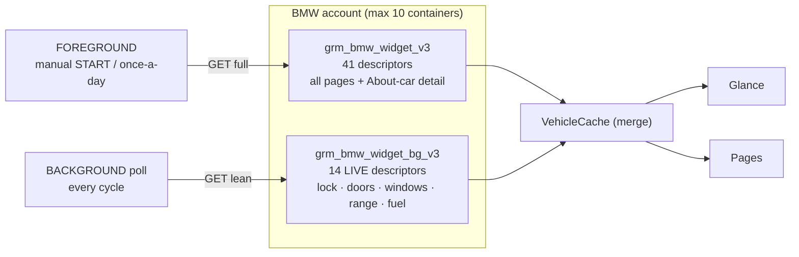
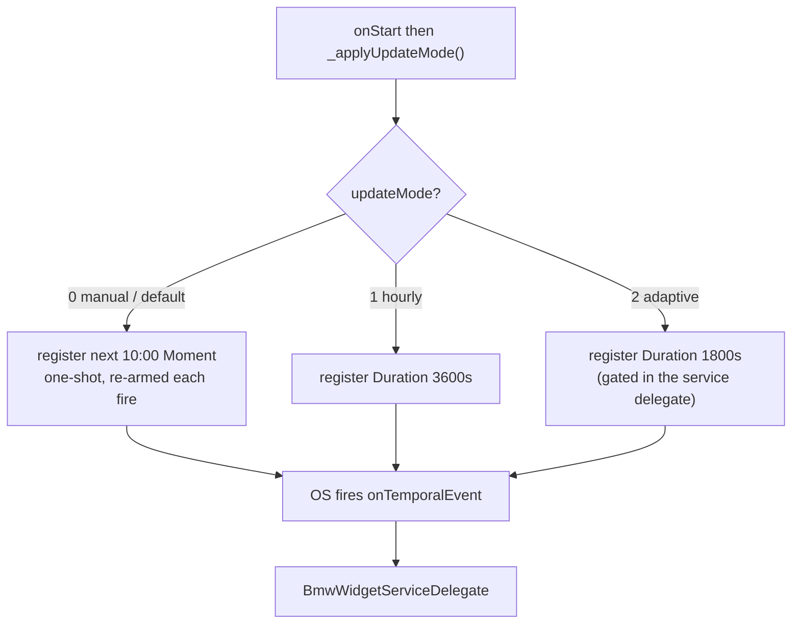
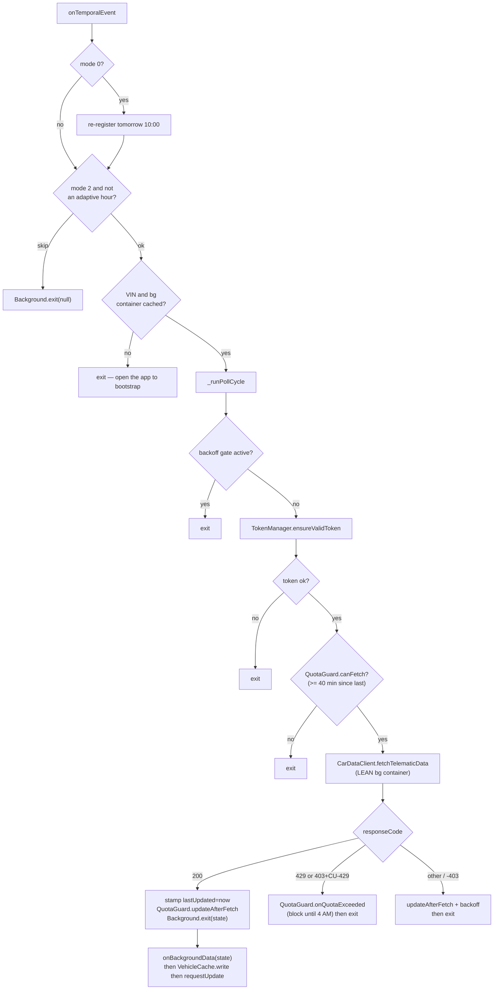
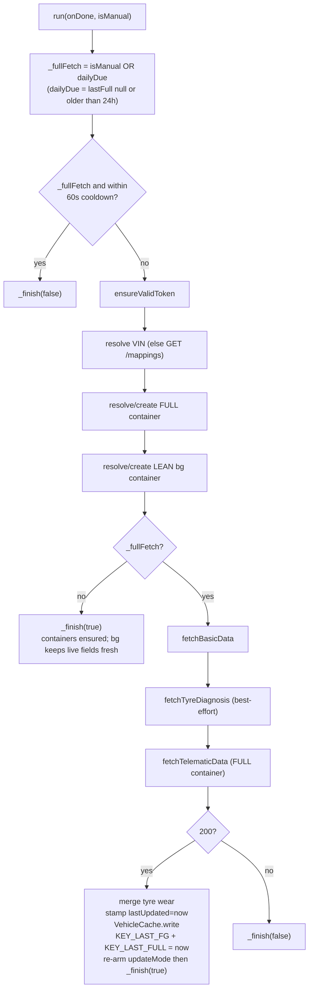
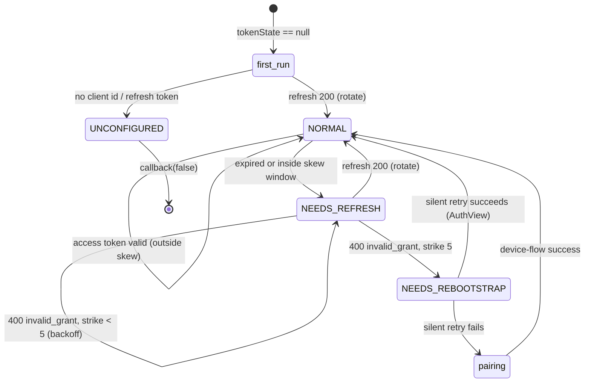
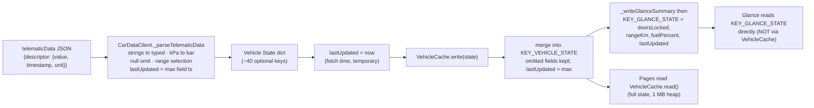
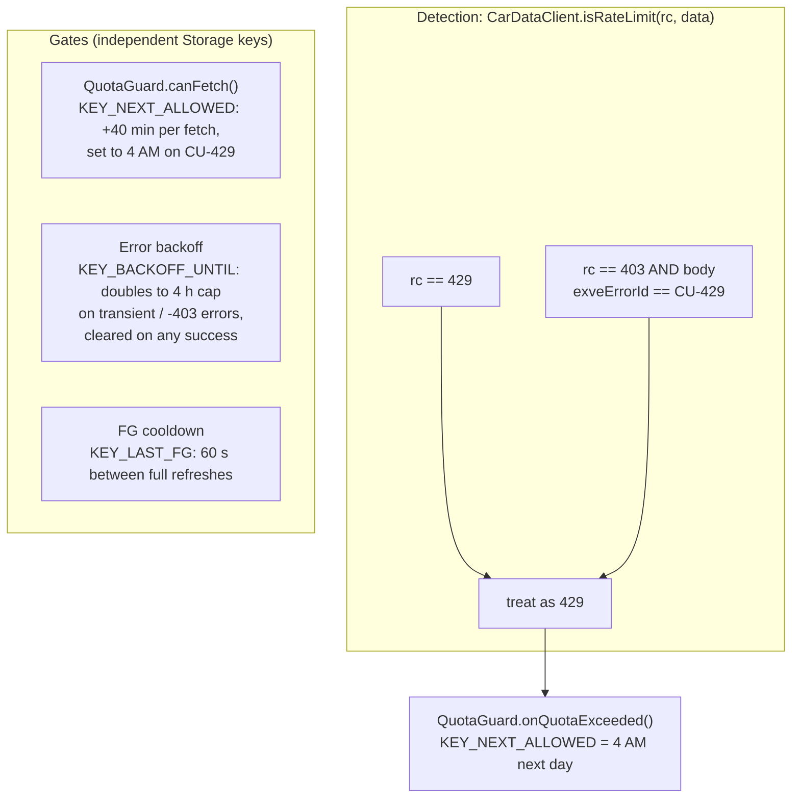
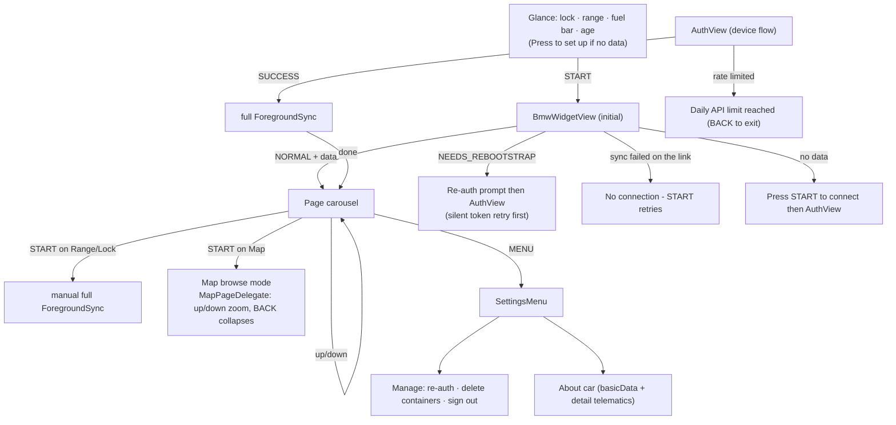
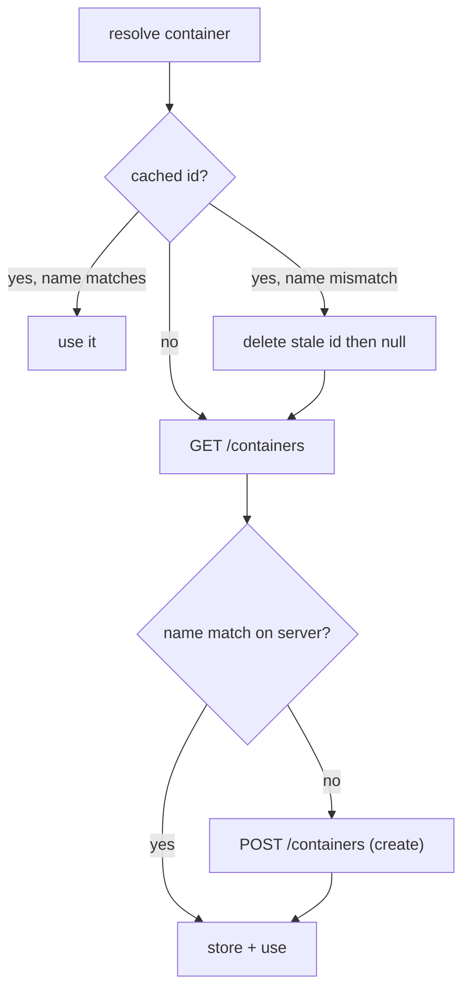

# BMW Widget — Architecture & Logic

A Garmin Connect IQ **widget** (Monkey C) that shows BMW CarData vehicle status — range,
fuel, lock/doors/windows, tyres, odometer, plus an "About car" detail menu — on the watch
face glance and a small page carousel.

> **The one design driver:** the watch runs the app in **two separate processes with very
> different memory budgets**. Everything below — the two-container model, the foreground/
> background class split, the cache projection — exists to live within the **~28 KB
> background heap**.

| Process | Heap | What runs there |
|---|---|---|
| **Foreground app** | ~1 MB on fēnix 6 Pro · **64 KB on base fēnix 6** | UI, pairing, the full data sync, cache writes |
| **Glance** | ~28 KB (own partition) | the glance view only — reads a lean projection |
| **Background service** | **~28 KB** | the periodic poll: token → fetch → parse → exit |

A response that parses fine in the 1 MB foreground returns
**`-403 NETWORK_RESPONSE_OUT_OF_MEMORY`** in the background — the original "background never
updates" bug. The fix: the background polls a **lean container** whose response fits.

---

## 1. Process & component map

`(:background)`-tagged classes load into the background process; everything else is
foreground-only. The background loads **whole classes**, so heavy foreground-only code
(VIN discovery, container create/delete, the 41-descriptor array) lives in a separate
class to keep it out of the background image.

**Why CarDataClient was split from CarDataBootstrap:** the background poll only needs the
telematic fetch + parser. VIN discovery, container create/list/delete, basicData, tyre, and
the 41-string descriptor array are foreground-only. Putting them in `CarDataBootstrap`
(not `(:background)`) keeps that bytecode out of the 28 KB background image. Shared statics
(`_DATA_HOST`, `_buildHeaders`, `_CONTAINER_NAME`, `_storeContainer`, `cachedContainerId`)
stay on `CarDataClient`.

---

## 2. The two-container model

A **container** is a server-side subscription to a set of descriptors; `telematicData`
returns exactly that container's fields in one GET. The app keeps **two**:

- The **lean (bg) container** holds only **live / event-driven** fields, small enough that
  its ~5 KB response fits the background heap. Its name is **version-stamped** (`_bg_v3`);
  bumping it forces re-creation with a new descriptor set.
- The **full container** carries everything (incl. the 12 "About car" telematics).
- `VehicleCache.write` **merges**, so the slow/static fields (tyres, odometer, service,
  About-car) from the last full fetch persist while the background keeps the live fields
  fresh.

| Field group | In bg (lean) container? | Refreshed by |
|---|---|---|
| Lock, doors, trunk, hood | ✅ | background poll |
| Windows | ✅ | background poll |
| Range (`totalRemainingRange` → `rangeKm`), fuel %, fuel L | ✅ | background poll |
| Tyres (pressure/target), odometer, service distance, displayUnit | ❌ | full fetch (manual / daily) |
| About-car detail (battery V, coolant, location, SOC, CBS, teleservice…) | ❌ | full fetch (manual / daily) |

> ⚠️ **Known gap (deferred D1):** the lean container has `totalRemainingRange` but not
> `lastRemainingRange` / `kombiRemainingElectricRange`. On an **ICE** car `total == last`,
> so it's fine; a **BEV/PHEV** whose only live source is the electric range won't get
> `rangeKm` from the background poll.

---

## 3. Entry points & poll cadence

`BmwWidgetApp` (the only class needed in both processes) wires the four CIQ entry points and
registers the background temporal event based on `updateMode`.

- **0 manual (default):** one daily ~10:00 fetch (keeps the OAuth token pair alive); the
  Moment is one-shot, so `onTemporalEvent` re-registers tomorrow's 10:00.
- **1 hourly:** fires every 3600 s.
- **2 adaptive:** fires every 1800 s but `_adaptiveShouldFetch()` only lets it fetch at
  chosen hours (00, 06–08, every 30 min 09–22, 23 top-up).
- Regardless of mode, **`QuotaGuard` enforces a 40-min minimum** between actual fetches.

---

## 4. Background poll (the fixed path)

`Background.exit(state)` ends the service and hands `state` to the **foreground**
`onBackgroundData`, which merges it into the cache and refreshes the glance projection.

---

## 5. Foreground sync — full vs. live, manual vs. daily

`ForegroundSync.run(onDone, isManual)` is the cold-start + refresh chain. It always ensures
**both** containers exist, but only does the heavy **full** fetch when warranted:

| Trigger | `isManual` | Result |
|---|---|---|
| Pairing complete (AuthView) | `true` | full fetch (first data) |
| START on Range/Lock page | `true` | full fetch (subject to 60 s cooldown) |
| App open (auto, BmwWidgetView) | `false` | full only if >24 h since last; else ensure-containers + rely on bg |

**Rate-limit short-circuit (`_stop429`)** is checked at every chain step: a `429`
(incl. normalized `403+CU-429`) sets `_rateLimited`, calls `QuotaGuard.onQuotaExceeded()`,
stamps the 60 s cooldown, and `_finish(false)`. The owning view reads `isRateLimited()` to
show "Daily limit reached" instead of bouncing to auth. **`_stop401`** sits beside it:
a `401` invalidates the cached access-token expiry and re-runs the chain once with a
freshly refreshed token (`_retried401` caps it at one retry).

---

## 6. Token lifecycle (TokenManager FSM)

Token **refresh** hits `customer.bmwgroup.com` and is **quota-exempt** (separate host from
the data API). The FSM state lives in `KEY_TOKEN_STATE`.

Pairing (`DeviceAuthManager`, foreground only) is OAuth 2.0 **Device Authorization Grant +
PKCE**: POST `/device/code` → show user code → poll `/token` until approved → store tokens
→ `NORMAL`. On success the AuthView runs a manual `ForegroundSync`. Token rotation always
writes the **refresh token before the access token** (so an interrupted rotation is
recoverable), and a `200` that omits `refresh_token` leaves the stored one untouched.

### Why the FSM is defensive about `invalid_grant`

BMW rotates the refresh token on **every** refresh, which makes a poor connection
dangerous: if the POST reaches BMW but the response is lost on the phone bridge, BMW has
burned the old token and the watch never received the new one. The next attempt then gets
a perfectly genuine `400 invalid_grant` — indistinguishable from a truly dead grant. Two
overlapping refreshes produce the same thing: the loser presents an already-rotated token.

`NEEDS_REBOOTSTRAP` is a **one-way door** — `ensureValidToken()` short-circuits on it
before any network call — so latching it on a single `invalid_grant` turns a BLE dropout
into a permanent "Re-auth needed". Three guards keep that from happening:

| Guard | Key | Effect |
|---|---|---|
| **Corroboration** (`GRANT_STRIKES_TO_LATCH = 5`) | `KEY_GRANT_STRIKES` | strikes 1–4 behave like any transient failure (backoff, state untouched); only the 5th latches. Any successful refresh clears the count. A high threshold only delays the prompt — cached data stays on screen under a "No connection" note, and Settings → *Re-pair* is always available. Spread over the doubling backoff (40 m, 80 m, 160 m, 4 h, 4 h) an unattended watch latches in ~12 h; tapping START burns the strikes immediately. |
| **Serialization** (`INFLIGHT_TTL_SECONDS = 90`) | `KEY_REFRESH_INFLIGHT` | one refresh at a time across views *and* processes (they share Storage). A caller arriving mid-refresh fails transiently. The TTL self-heals a stamp left by a killed process. |
| **Silent retry** | — | opening the re-link prompt spends one quota-exempt refresh via `TokenManager.retryAfterRebootstrap()` before showing the device flow; success clears the latch outright. Settings → *Re-pair* opts out (`AuthView.setAllowRecover(false)`) because the user asked for pairing by name. |

`EXPIRY_SKEW_SECONDS = 300` refreshes early: a token still valid when the request leaves
the watch can expire in flight, and the data path reads the resulting `401` as a transient
error. A `401` on a data call therefore also calls `TokenManager.invalidateAccessToken()`
(drops `KEY_ACCESS_EXPIRY`) — the foreground re-runs the chain once with a fresh token,
the background poll picks it up on the next tick.

### Failure classification (why a dropout no longer asks for a re-auth)

`ForegroundSync` exposes three failure kinds, and the views branch on all three —
`isRateLimited()`, `authFailed()`, otherwise transient. **Only `authFailed()`
(`UNCONFIGURED` / `NEEDS_REBOOTSTRAP`) may open the device flow.** A `-104`, a timeout, a
`5xx` or a failed container list keeps the cached data on screen under a "No connection"
note. `run()` also pre-flights `System.getDeviceSettings().phoneConnected`, so an
unreachable phone never enters the chain at all.

---

## 7. Data flow: fetch → parse → cache → render

**Why the glance reads `KEY_GLANCE_STATE` directly:** referencing `VehicleCache` from the
`(:glance)` view would pull its write/merge bytecode into the glance image, and
deserializing the full ~40-key state in the ~28 KB glance partition OOMs (the 2026-06-15
crash). The lean 4-field projection is written by **every** cache writer. `fuelLitres` is
deliberately *not* projected — the glance derives its "+NNL to fill" from `fuelPercent` via
`FuelMath`, because BMW leaves `remainingFuel` frozen at the last refuel (B12).

> **"last upd" = fetch time (temporary):** both fetch paths overwrite `lastUpdated` with the
> wall clock at fetch completion, so the age resets to ~now on every successful poll rather
> than tracking the vehicle's report time. Marked temporary "till we stabilize"; the
> parser's max-timestamp machinery is dormant, not removed.

---

## 8. Rate limit, quota & backoff

Three independent gates, all keyed in Storage:

- **CU-429 is the key insight:** BMW returns its **daily limit as HTTP `403` with body
  `exveErrorId == "CU-429"`**, *not* HTTP 429. `isRateLimit` normalizes both → callers arm
  the 24 h block and show a clear message (no false "auth needed").
- `KEY_NEXT_ALLOWED` (quota gate) and `KEY_BACKOFF_UNTIL` (error backoff) are **separate**:
  the gate advances on every call; backoff is set on errors and cleared on success. "Cleared
  on success" is `QuotaGuard.clearBackoff()`, called from the token refresh, the background
  poll and the foreground sync — without it the backoff only ever doubles, and one bad patch
  of connectivity keeps the poll blocked for up to 4 h after the link is back.

---

## 9. UI / navigation

Pages: **RangeFuel** (range + fuel/SOC bar + consumption est.), **Lock** (lock state + all
doors/windows/trunk/hood), **Odometer** (odometer + service distance), **Tyres** (per-tyre
pressure/target + wear km, START cycles the three views), and **Map** (FR-27..FR-40 — the
car's last known position on the device's onboard cartography; the only page extending
`WatchUi.MapView`, and the only one with its own delegate, `MapPageDelegate`, so BACK
collapses browse mode instead of exiting and up/down zoom instead of paging). A page is
visible only when its key fields are present (`isVisible()`), so the carousel grows as
data arrives — the map needs both `lat` and `lon`.

The map occupies a **build-variant fifth slot**: `PageNav._pageCount()` is a `(:mapPage)` /
`(:noMapPage)` function pair, so the carousel is 5 pages on map-capable devices and 4
elsewhere (see §12).

---

## 10. Storage keys

| Key | Written by | Read by |
|---|---|---|
| `KEY_TOKEN_STATE` | TokenManager, DeviceAuthManager, sign-out | TokenManager, views |
| `KEY_ACCESS_TOKEN` / `KEY_ACCESS_EXPIRY` / `KEY_REFRESH_TOKEN` | TokenManager (refresh **before** access) | TokenManager |
| `KEY_VIN` | CarDataBootstrap (mappings) | both sync paths |
| `KEY_CONTAINER_ID` / `_NAME` | `_storeContainer` | `cachedContainerId` (FULL) |
| `KEY_BG_CONTAINER_ID` / `_NAME` | `_storeBgContainer` | `cachedBgContainerId` (LEAN) |
| `KEY_VEHICLE_STATE` | VehicleCache.write (merge) | pages |
| `KEY_GLANCE_STATE` | `_writeGlanceSummary` (every write) | glance (direct) |
| `KEY_VEHICLE_NAME` / `KEY_BASIC_DATA` / `KEY_DRIVE_TYPE` | basicData | About menu, header |
| `KEY_NEXT_ALLOWED` | QuotaGuard | QuotaGuard.canFetch |
| `KEY_BACKOFF_UNTIL` | TokenManager / ServiceDelegate (set on error, cleared on every success) | poll backoff gate |
| `KEY_REFRESH_INFLIGHT` | TokenManager (stamp on dispatch, cleared on response) | refresh serialization, 90 s TTL |
| `KEY_GRANT_STRIKES` | TokenManager (on `invalid_grant`; cleared on success / sign-out) | `NEEDS_REBOOTSTRAP` corroboration |
| `lastForegroundSync` (`KEY_LAST_FG`) | full success, rate-limit | 60 s cooldown |
| `lastFullFetch` (`KEY_LAST_FULL`) | full success | daily full-fetch gate |

---

## 11. Container resolution & versioning

`cachedContainerId()` / `cachedBgContainerId()` return the stored id **only if** the stored
name matches the current `_CONTAINER_NAME` / `_BG_CONTAINER_NAME`; otherwise they delete the
stale id and return null, forcing re-creation. Bumping a name (e.g. `_bg_v2` → `_bg_v3`) is
how a descriptor-set change is rolled out.

> **Orphan cleanup:** each version bump orphans the old container server-side (two per
> version now), creeping toward BMW's per-account cap over many versions/re-pairs.
> **Manage → "Delete containers"** lists and deletes **every** container on the account
> (incl. old-version orphans), then clears the local ids so the next sync re-creates the
> current pair — so the cap can be reclaimed on demand. Automatic pruning at bootstrap is
> still not done.

---

## 12. Build tiers (the annotation split)

One source tree, several device capabilities. Each jungle
([`monkey.jungle`](../monkey.jungle), [`iq.jungle`](../iq.jungle),
and the gitignored personal `livetest.jungle`) resolves them with `excludeAnnotations` on three
**orthogonal** axes, each a pair where exactly one side survives a given device build:

| Axis | Annotations | Split |
|---|---|---|
| **Scheduling** | `(:bgPoll)` / `(:manualOnly)` | API 6.0+ devices get hourly + adaptive update modes; API < 6.0 gets manual + the daily 10:00 fetch only, and the Update Mode setting is hidden (a different `resources-modes-*` settings XML). |
| **Design** | `(:designNew)` / `(:designClassic)` | The AMOLED refresh (anti-aliasing, pill bars) on the API 6.0+ tier; the original look byte-identical on legacy. |
| **Map page** | `(:mapPage)` / `(:noMapPage)` | `WatchUi.MapView` needs onboard cartography — 32 of the 36 declared products have it; base fēnix 6, fēnix 6S, FR255 and FR745 do not. |

Seven products are on the full tier: fēnix 8 (43/47 mm), fēnix 8 Pro, fēnix 8 Solar
(47/51 mm), fēnix E, FR970. Everything else falls through to `base`.

Two traps worth knowing:

- **Jungle values REPLACE, they don't merge.** A device line must restate its *whole*
  exclusion list, which is why each per-device line repeats the base annotations.
- **A jungle qualifier for a device whose SDK profile isn't installed locally breaks
  every build**, not just that device's — which is why `fenix6s` and `fr745` still have no
  map-tier line (see the TODO in the jungles). `PageNav` therefore also guards
  instantiation with `WatchUi has :MapView` at runtime: compiling map code for a
  map-incapable device *succeeds*, so the annotation is not a safety net on its own.

---

## 13. Key invariants (do not break)

- **No `makeWebRequest` in the foreground `AppBase`** — network I/O is in the background
  service and the foreground sync/auth classes.
- **Anything reachable from the background must be `(:background)`** — the bg process loads
  only tagged classes; a missing tag → `Illegal Access (Out of Bounds)` at load.
- **The glance must not reference `VehicleCache`** — it reads `KEY_GLANCE_STATE` directly.
- **Keep the bg container small** — it must fit the ~28 KB heap (a `-403` means it's too
  big; trim `_bgContainerDescriptors`).
- **Token rotation writes the refresh token before the access token** (atomic-rotation rule),
  and never writes a null over it — a `200` without `refresh_token` leaves the stored one.
- **`NEEDS_REBOOTSTRAP` is latched only on corroborated evidence** — it is a one-way door;
  a single `invalid_grant` may be a lost rotation, not a dead grant.
- **Only `ForegroundSync.authFailed()` may send the user to pairing** — a link-level failure
  gets a note, never the device flow.
- **Every success clears the error backoff** (`QuotaGuard.clearBackoff()`) — the gate is
  only ever doubled otherwise.
- **Always use `StorageKeys.KEY_*`** — never inline a storage key string.
- **Every tier annotation needs both halves** (`:mapPage`/`:noMapPage`, `:bgPoll`/`:manualOnly`,
  `:designNew`/`:designClassic`) — a symbol excluded on one tier with no counterpart on the
  other fails that tier's build, not the one you were editing.

---

*See also: [findings/connectiq-gotchas.md](findings/connectiq-gotchas.md) (platform limits),
[findings/bmw-cardata-api.md](findings/bmw-cardata-api.md) (API behaviour),
[TESTING.md](TESTING.md) (build/run the suite on both tiers).*
