# Architecture Diagrams

Rendered from the Mermaid blocks in [../ARCHITECTURE.md](../ARCHITECTURE.md). These `.svg`
images display in any markdown viewer / browser (no Mermaid plugin needed). The `.mmd`
sources are alongside each — edit those (or the blocks in `ARCHITECTURE.md`) and re-render:

```sh
cd docs/diagrams
for f in *.mmd; do npx -y @mermaid-js/mermaid-cli -i "$f" -o "${f%.mmd}.svg" -b transparent; done
```

---

## 1. Process & component map


## 2. Two-container model


## 3. Entry points & poll cadence


## 4. Background poll (the fixed path)


## 5. Foreground sync (full vs. live, manual vs. daily)


## 6. Token lifecycle (FSM)


## 7. Data flow: fetch → parse → cache → render


## 8. Rate limit, quota & backoff


## 9. UI / navigation


## 10. Container resolution & versioning

