# BMW Status — Garmin Connect IQ -widget

[English](../../README.md) · [Deutsch](README.de.md) · [Français](README.fr.md) · [Español](README.es.md) · [Nederlands](README.nl.md) · [Italiano](README.it.md) · [Polski](README.pl.md) · [Svenska](README.sv.md) · **Suomi** · [Ελληνικά](README.el.md)

**[Siirry käyttöönottoon ↓](#käyttöönotto)**

> Käännös README:n käyttäjille tarkoitetuista osista — epäselvissä tapauksissa ratkaisee [englanninkielinen README](../../README.md). Rakentamisen, arkkitehtuurin ja testauksen dokumentaatio on vain englanniksi. Kuvakaappaukset ovat BMW:n espanjankielisestä portaalista; nimet ja ulkoasu omassa maassasi voivat poiketa. Kellon käyttöliittymä on englanniksi.

Garmin-**widget**, joka näyttää BMW:si reaaliaikaisen tilan kellossasi — toimintamatka, polttoaine, lukitus, ovet/ikkunat, renkaat, matkamittari ja huoltotiedot — suoraan virallisesta [BMW CarData](https://bmw-cardata.bmwgroup.com/customer/public/api-specification) REST API:sta.

> Harrasteprojekti. Ei ole sidoksissa BMW:hen tai Garminiin, eivätkä ne ole hyväksyneet tai tue sitä.

## Ominaisuudet

- **Glance** — lukituksen tila, toimintamatka ja polttoaine yhdellä silmäyksellä widget-karusellissa.
- **Toimintamatka ja polttoaine** — jäljellä oleva toimintamatka, polttoaine %, litrat tankissa / täyteen ja valinnainen kulutusarvio (`~L/100 km`). Sähköautot ja ladattavat hybridit: akun varaus % ja sähköinen toimintamatka.
- **Lukitus** — SECURED / UNLOCKED, piste jokaiselle avoimelle ovelle (edessä + takana), konepellille ja takaluukulle sekä punainen **W**-merkki, kun ikkuna on auki. Selkeä ilmaisin tietojen iästä.
- **Matkamittari** — kokonaiskilometrit ja matka seuraavaan huoltoon (valinnaisella omalla arvolla).
- **Renkaat** — rengaspaine pyörittäin tavoitepaineeseen verrattuna sekä arvio renkaiden kulumisesta (START vaihtaa kolmen näkymän välillä).
- **Auton sijainti** — pysäköity autosi kellon omalla kartalla; START kytkee selattavan zoomausnäkymän päälle tai pois. Vain laitteissa, joissa on kartat (kaikki tuetut paitsi Forerunner 255, 255 Music, 265 ja 745).
- **About car** — ryhmitelty, vain luettava yhteenveto ajoneuvon kiinteistä tiedoista ja reaaliaikaisesta telematiikasta (12 V:n akku, jäähdytysneste, sijainti, Teleservice, …).
- **Asetukset kellossa** — päivitystila, tankin koko, oma arvo seuraavalle huollolle, kulutusarvion kytkin ja **Manage**-alivalikko (uudelleenpariutus / uloskirjautuminen / kaikkien säiliöiden poisto).

## Tuetut laitteet

Garmin fēnix-, epix-, Enduro-, MARQ- ja Forerunner-kellot. Ajantasainen luettelo — ja tieto siitä, mitä laitteita ei tueta — on [englanninkielisessä README:ssä](../../README.md#supported-devices).

## Käyttöönotto

Tarvitset **BMW CarData Client ID:n** (ilmainen, luodaan BMW CarData -portaalissa) ja My BMW -tilin maassa, jossa CarData on saatavilla (EU / Iso-Britannia). Kaikki muu tapahtuu automaattisesti: kello löytää VIN-tunnuksesi ja luo omat tietosäiliönsä (data containers).

### 1. BMW CarData -asiakkaan luominen

Kertaluonteinen, noin 10 minuuttia. Portaalin nimet vaihtelevat kielen mukaan; tässä esimerkkinä ovat espanjankieliset — ne näkyvät myös kuvakaappauksissa.

1. Kirjaudu oman maasi **My BMW -verkkoportaaliin** ja avaa ajoneuvon yleisnäkymä — esim. `https://www.bmw.es/es-es/mybmw/vehicle-overview`.
2. Avaa **BMW CARDATA**.
3. Luo teknisen käyttöoikeuden osiossa — *Technical access to BMW CarData* / ES *ACCESO TÉCNICO A BMW CARDATA* — **asiakas (client)** ja kopioi **Client ID**.
4. Kytke **molemmat** kytkimet päälle: *CarData API access* (ES *Solicitar acceso a la API de CarData*) ja *CarData streaming* (ES *Transmisión de CarData*). Widget pyytää kirjautuessa molemmat käyttöoikeudet yhdessä, joten kummankin on oltava päällä, vaikka vain REST API:a käytetään.

   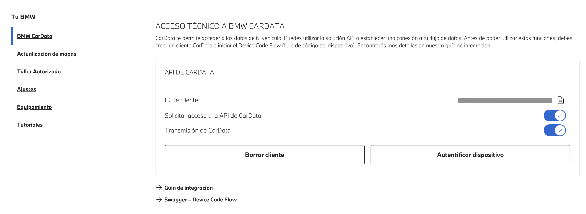

5. Avaa streaming-osiossa **tietojen valinta** (ES *Cambiar selección de datos*) ja valitse osion 2 tietokentät. Kaiken valitseminen toimii myös — widget ei koskaan pyydä mitään tämän luettelon ulkopuolelta.

   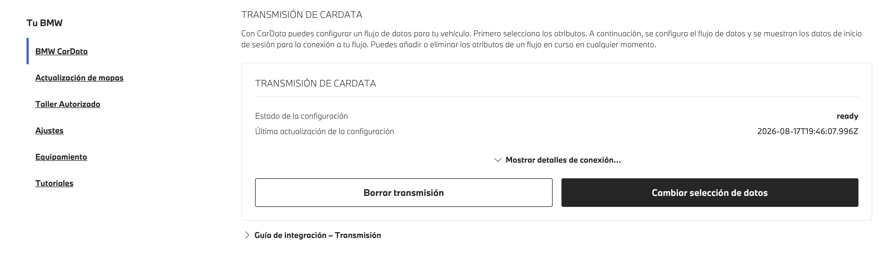

6. Tallenna ja **odota 5–10 minuuttia**: juuri luotu asiakas ei ole heti käytettävissä.

### 2. Tietokenttien valinta

Kyseessä ovat täsmälleen widgetin "täyden" säiliön **41 tietokenttää**. Luettelo (tekniset tunnisteet, kaikissa kielissä samat) on englanninkielisessä README:ssä: [Select the data fields](../../README.md#2-select-the-data-fields).

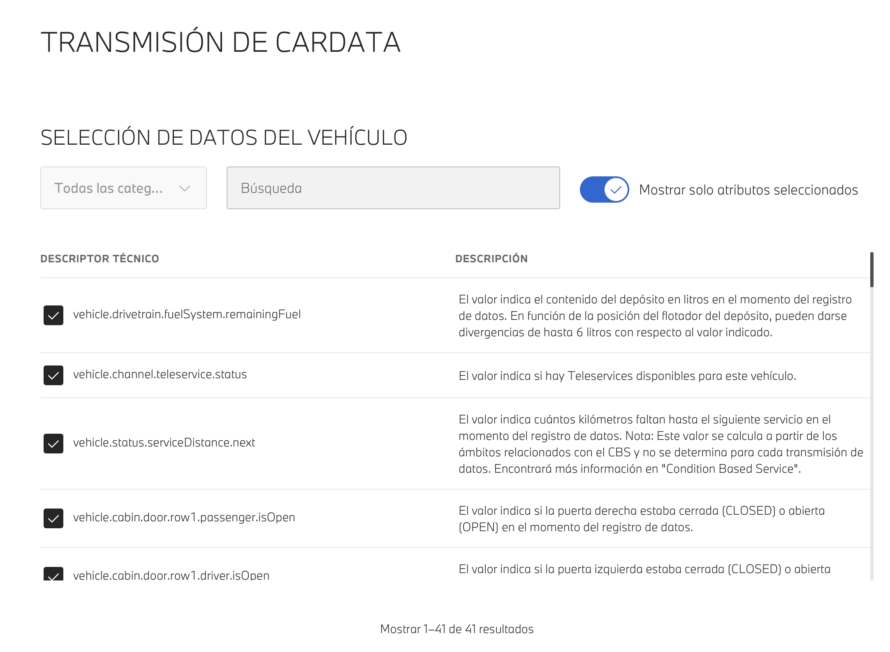

Vinkki: kytke päälle suodatin, joka näyttää vain valitut attribuutit (ES *Mostrar solo atributos seleccionados*), niin voit tarkistaa valintasi.

### 3. Kellon pariutus

1. **Garmin Connect** → laitteesi → *Connect IQ Apps* → **BMW Status** → *Settings* → *Required* → liitä **Client ID**. Jätä VIN ja Container ID tyhjiksi.

   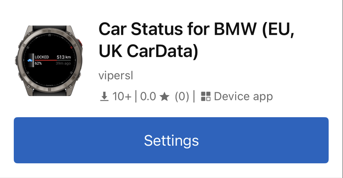 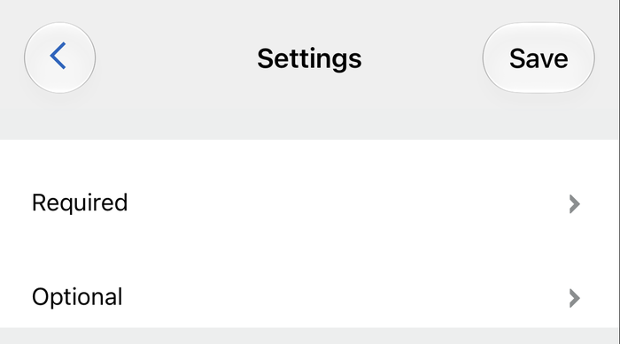 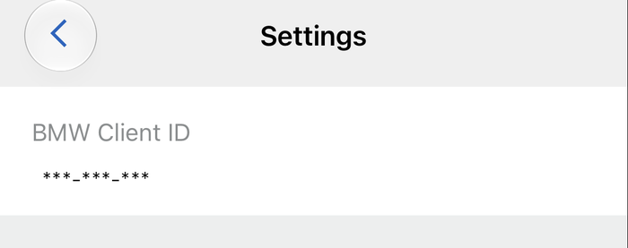 
   Vasemmalta oikealle: sovellus Garmin Connectissa ja sen ”Settings”-painike, asetusryhmät ja ”BMW Client ID” -kenttä.

2. Avaa widget → **START to connect**. Näkyviin tulee pariutuskoodi ja linkki.

   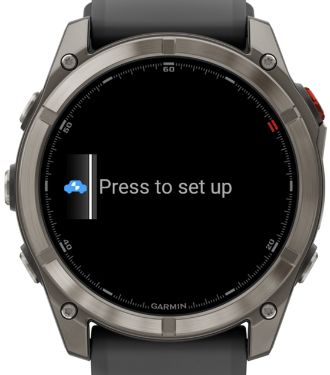 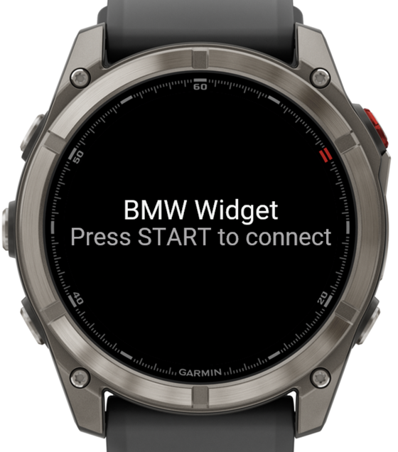 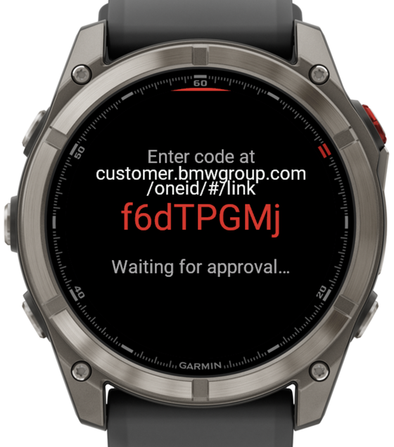 
   Vasemmalta oikealle: glance widget-karusellissa, widgetin aloitusnäyttö ja pariutuskoodi linkkeineen.

3. Hyväksy koodi kellon näyttämässä linkissä (BMW antaa sen koodin mukana; muuten `customer.bmwgroup.com/oneid/#/link`) puhelimella tai tietokoneella ja kirjaudu BMW-tililläsi.

   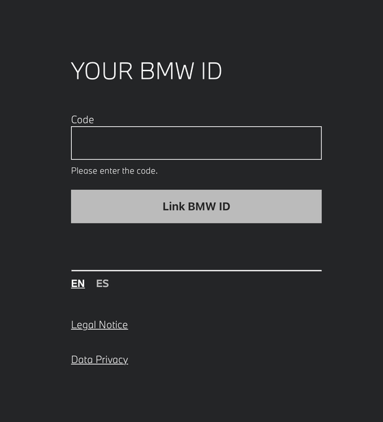 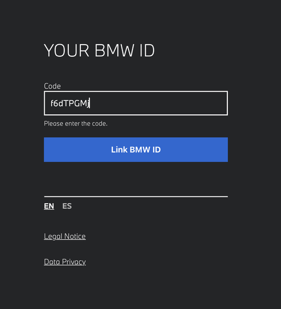 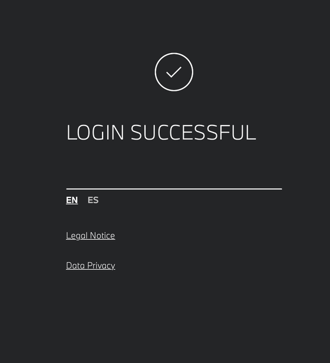 
   Vasemmalta oikealle: BMW:n sivu koodin syöttämiseen (tässä englanniksi), syötetty koodi ja vahvistus.

4. Kello löytää VIN-tunnuksesi, luo molemmat säiliöt ja hakee autosi tiedot. VIN-tunnusta tai säiliöitä ei tarvitse kirjoittaa. Refresh token on voimassa noin 2 viikkoa ja uusiutuu jokaisella käytöllä — säännöllisesti avaamasi widget pysyy pariutettuna.

### Päivitys

- **START** sivulla *Range & Fuel* tai *Lock* → täysi päivitys heti (60 s odotusaika). Sivulla *Tyres* START vaihtaa näkymää (todellinen/tavoite/kuluma), karttasivulla se kytkee zoomauksen, sivulla *Odometer* se ei tee mitään.
- **Kerran päivässä noin klo 10:00** — täysi haku myös manuaalitilassa; se pitää myös kirjautumisen (tokenit) voimassa.
- **Update Mode** (*Auto hourly* / *Auto adaptive*) on vain **API 6.0+** -laitteissa — fēnix 8, 8 Pro, 8 Solar, fēnix 9 (kaikki variantit), fēnix E, Enduro 3 / 4, MARQ Gen 3, FR970. Kaikki muut laitteet päivittyvät manuaalisesti + päivittäin, ja asetus on piilotettu.
- BMW sallii **noin 50 tietokyselyä vuorokaudessa**. Täysi päivitys kuluttaa 3, taustakysely 1; tokenin uusiminen ei lasketa mukaan.
- Tietojen tuoreus riippuu **autosta**, ei widgetistä: pysäköity BMW voi raportoida vain muutaman tunnin välein. Siksi sivut näyttävät tietojen iän.

### Vianmääritys

| Näkymä / oire | Syy / ratkaisu |
|---|---|
| `BMW Widget` / `Add Client ID in the Garmin Connect app` | Asetuksissa ei ole vielä Client ID:tä — vaihe 3.1. Liitetyn arvon alussa ja lopussa olevat välilyönnit ohitetaan. |
| `Auth failed` → `Client ID looks incomplete — copy it again…` | BMW hylkäsi pariutuksen, eikä tallennettu arvo ole täydellinen 36 merkin Client ID — yleensä liitettiin vain puolet. Kopioi se uudelleen portaalista. |
| `Phone link lost — retrying…` pariutuksen aikana | Kello menetti hetkeksi yhteyden Garmin Connectiin (yleistä, jos hyväksyt samalla puhelimella). Koodi on yhä voimassa; viimeistele hyväksyntä — kello jatkaa itsestään. |
| `No car on this BMW account` | BMW ID:llesi ei ole ajoneuvoa, tai et ole sen **ensisijainen** käyttäjä. CarData palvelee vain ensisijaista käyttäjää. |
| `Car not readable — check VIN` | Asetuksissa oleva VIN on väärä, tai auto ei ole enää tällä tilillä. Tyhjennä VIN-kenttä, jotta widget löytää sen itse. |
| `No car data yet` / `Check data selection in BMW portal` | Haku onnistui, mutta se ei palauttanut mitään näytettävää: tietokenttiä ei ole valittu (vaihe 1.5) tai auto ei ole raportoinut sen jälkeen. |
| Pariutus epäonnistuu heti asiakkaan luomisen jälkeen | Portaalin 5–10 minuutin aktivointi ei ole vielä valmis; yritä uudelleen. |
| `Re-auth needed` / `Press START to re-pair` | Refresh token on vanhentunut (widgetiä ei ole avattu yli ~2 viikkoon) → **Manage → Re-pair**. |
| `Auth failed` → `Check CarData API + streaming are on in the BMW portal` | Toinen asiakkaasi kahdesta kytkimestä on portaalissa pois päältä (vaihe 1.4). Widget pyytää molemmat käyttöoikeudet yhdellä pyynnöllä, joten BMW hylkää koko pariutuksen. Kytke se uudelleen päälle, odota **5–10 min** ja paina START uudelleen. |
| Säiliövirhe / `CU-124` | BMW sallii tilillä enintään **10 säiliötä**. Käyttöönotto tarjoaa kaikkien poistamista ja uutta yritystä; muuten **Manage → Delete containers** (widget luo omansa uudelleen). |
| Sivu puuttuu tai arvot ovat tyhjiä | Autosi (tai CarData-valintasi) ei raportoi kyseistä kenttää — sivut piilottavat itsensä, kun niiden pääasialliset tiedot puuttuvat. |

## Tietosuoja

Widget lukee ajoneuvosi tiedot vain näyttääkseen ne kellossasi; mitään ei lähetetä muualle kuin BMW:n omaan API:in — sovelluksen takana ei ole palvelinta, analytiikkaa eikä kolmansien osapuolten SDK:ita. Koko käytäntö (englanniksi): [`PRIVACY.md`](../../PRIVACY.md).
