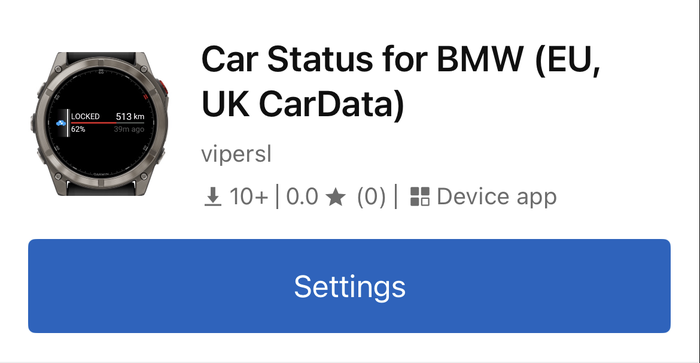
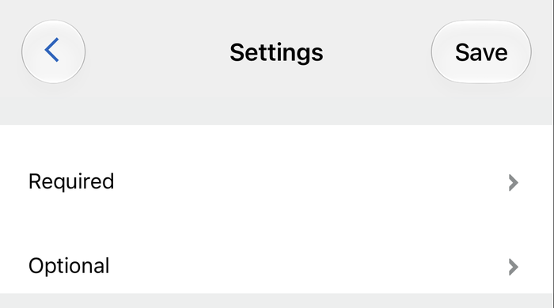
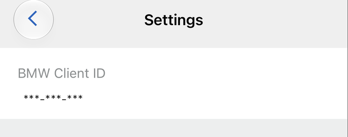
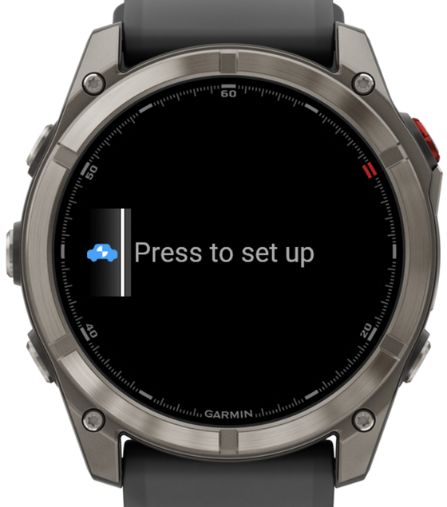
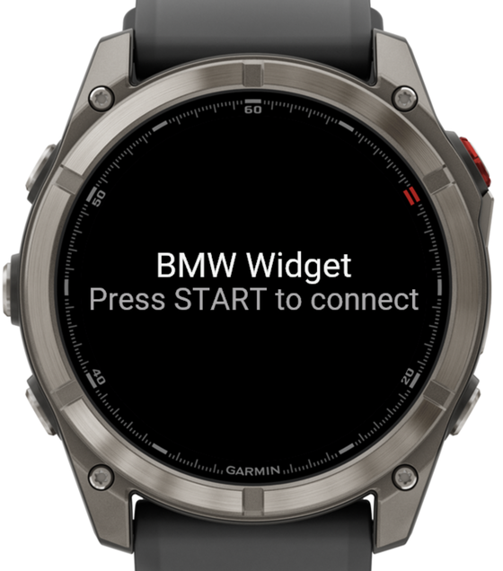
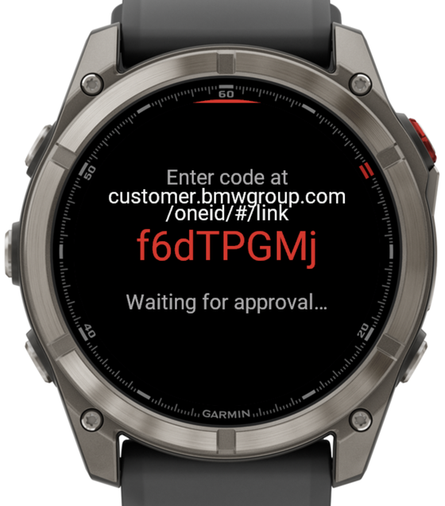
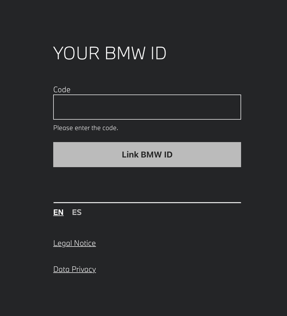
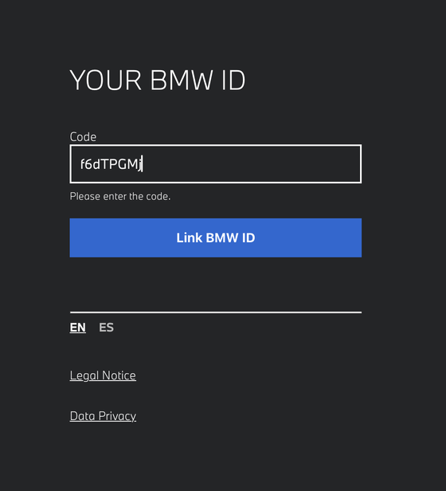
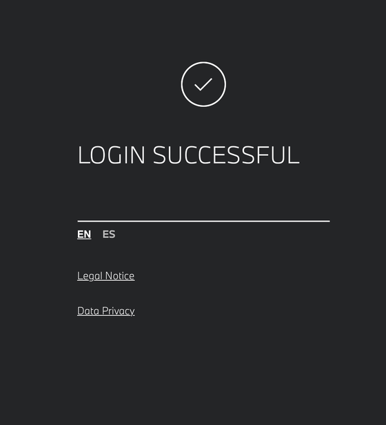

# BMW Status — widget Garmin Connect IQ

[English](../../README.md) · [Deutsch](README.de.md) · [Français](README.fr.md) · [Español](README.es.md) · [Nederlands](README.nl.md) · **Italiano** · [Polski](README.pl.md) · [Svenska](README.sv.md) · [Suomi](README.fi.md) · [Ελληνικά](README.el.md)

**[Vai alla configurazione ↓](#configurazione)**

> Traduzione delle parti del README pensate per gli utenti — in caso di dubbio fa fede il [README in inglese](../../README.md). La documentazione su build, architettura e test esiste solo in inglese. Gli screenshot provengono dal portale BMW in spagnolo; le etichette e il layout nel tuo paese possono essere diversi. L'interfaccia dell'orologio è in inglese.

Un **widget** Garmin che mostra sul tuo orologio lo stato in tempo reale della tua BMW — autonomia, carburante, chiusura, portiere/finestrini, pneumatici, contachilometri e informazioni di manutenzione — direttamente dall'API REST ufficiale [BMW CarData](https://bmw-cardata.bmwgroup.com/customer/public/api-specification).

> Progetto personale / hobbistico. Non affiliato, approvato o supportato da BMW o Garmin.

## Funzioni

- **Glance** — stato di chiusura, autonomia e carburante a colpo d'occhio nel carosello dei widget.
- **Autonomia e carburante** — autonomia residua, carburante in %, litri nel serbatoio / per il pieno e una stima facoltativa dei consumi (`~L/100 km`). Elettriche e ibride plug-in: batteria in % e autonomia elettrica.
- **Chiusura** — SECURED / UNLOCKED, un punto per ogni portiera aperta (anteriori + posteriori), cofano e bagagliaio, più un badge rosso **W** se un finestrino è aperto. Indicatore ben visibile dell'età dei dati.
- **Contachilometri** — chilometraggio e distanza dal prossimo tagliando (con valore personalizzato facoltativo).
- **Pneumatici** — pressione di ogni ruota rispetto al valore nominale e stima dell'usura (START scorre le tre viste).
- **Posizione dell'auto** — la tua auto parcheggiata sulla mappa integrata dell'orologio; START attiva o disattiva una vista con zoom esplorabile. Solo sui dispositivi con mappe (tutti quelli supportati tranne Forerunner 255, 255 Music, 265 e 745).
- **About car** — vista raggruppata, di sola lettura, con i dati fissi del veicolo e la telematica in tempo reale (batteria a 12 V, liquido di raffreddamento, posizione, Teleservice, …).
- **Impostazioni sull'orologio** — modalità di aggiornamento, capacità del serbatoio, valore personalizzato per il tagliando, stima dei consumi e il sottomenu **Manage** (riassociare / disconnettersi / eliminare tutti i container).

## Dispositivi supportati

Orologi Garmin fēnix, epix, Enduro, MARQ e Forerunner. L'elenco aggiornato — e i dispositivi non supportati — si trova nel [README in inglese](../../README.md#supported-devices).

## Configurazione

Ti serve un **Client ID BMW CarData** (gratuito, si crea nel portale BMW CarData) e un account My BMW in un paese in cui CarData è disponibile (UE / Regno Unito). Tutto il resto è automatico: l'orologio trova il tuo VIN e crea da solo i propri container di dati.

### 1. Creare un client BMW CarData

Una tantum, circa 10 minuti. Le etichette del portale cambiano da una lingua all'altra; qui si usano quelle spagnole come esempio — sono anche quelle degli screenshot.

1. Accedi al **portale web My BMW** del tuo paese e apri la panoramica del veicolo — ad es. `https://www.bmw.es/es-es/mybmw/vehicle-overview`.
2. Apri **BMW CARDATA**.
3. Nella sezione per l'accesso tecnico — *Technical access to BMW CarData* / ES *ACCESO TÉCNICO A BMW CARDATA* — **crea un client** e copia il **Client ID**.
4. Attiva **entrambi** gli interruttori: *CarData API access* (ES *Solicitar acceso a la API de CarData*) e *CarData streaming* (ES *Transmisión de CarData*). Il widget richiede entrambe le autorizzazioni insieme al momento dell'accesso, quindi devono essere attive tutte e due, anche se viene usata solo l'API REST.

   

5. Nella sezione streaming apri la **selezione dei dati** (ES *Cambiar selección de datos*) e spunta i campi dati della sezione 2. Selezionare tutto funziona ugualmente — il widget non richiede mai nulla al di fuori di quell'elenco.

   

6. Salva e **attendi 5–10 minuti**: un client appena creato non è utilizzabile subito.

### 2. Selezionare i campi dati

Sono esattamente i **41 campi dati** del container "completo" del widget. L'elenco (identificatori tecnici, uguali in tutte le lingue) è nel README in inglese: [Select the data fields](../../README.md#2-select-the-data-fields).

Suggerimento: attiva il filtro che mostra solo gli attributi selezionati (ES *Mostrar solo atributos seleccionados*) per ricontrollare la selezione.

### 3. Associare l'orologio

1. **Garmin Connect** → il tuo dispositivo → *Connect IQ Apps* → **BMW Status** → *Settings* → *Required* → incolla il **Client ID**. Lascia vuoti VIN e Container ID.

      
   Da sinistra a destra: l'app in Garmin Connect con il pulsante «Settings», i gruppi di impostazioni e il campo «BMW Client ID».

2. Apri il widget → **START to connect**. Compaiono un codice di associazione e un link.

      
   Da sinistra a destra: il glance nel carosello dei widget, la schermata iniziale del widget e il codice di associazione con il suo link.

3. Approva il codice al link mostrato dall'orologio (BMW lo fornisce insieme al codice; in alternativa `customer.bmwgroup.com/oneid/#/link`), da uno smartphone o da un computer, accedendo con il tuo account BMW.

      
   Da sinistra a destra: la pagina BMW per inserire il codice (qui in inglese), il codice inserito e la conferma.

4. L'orologio trova il tuo VIN, crea i due container e recupera i dati della tua auto. Non serve digitare VIN o container. Il refresh token dura circa 2 settimane e si rinnova a ogni utilizzo — un widget che apri regolarmente resta associato.

### Aggiornamento

- **START** nella pagina *Range & Fuel* o *Lock* → aggiornamento completo immediato (60 s di attesa tra un aggiornamento e l'altro). In *Tyres* START alterna reale/nominale/usura, nella pagina della mappa attiva o disattiva lo zoom, in *Odometer* non fa nulla.
- **Una volta al giorno verso le 10:00** — recupero completo anche in modalità manuale; tiene vivo anche l'accesso (token).
- **Update Mode** (*Auto hourly* / *Auto adaptive*) esiste solo sui dispositivi **API 6.0+** — fēnix 8, 8 Pro, 8 Solar, fēnix 9 (tutte le varianti), fēnix E, Enduro 3 / 4, MARQ Gen 3, FR970. Tutti gli altri dispositivi funzionano in modo manuale + giornaliero e l'impostazione è nascosta.
- BMW consente **circa 50 chiamate dati ogni 24 ore**. Un aggiornamento completo ne usa 3, un polling in background 1; il rinnovo del token non conta.
- La freschezza dei dati dipende dall'**auto**, non dal widget: una BMW parcheggiata può trasmettere solo ogni poche ore. Per questo le pagine mostrano l'età dei dati.

### Risoluzione dei problemi

| Schermata / sintomo | Causa / soluzione |
|---|---|
| `BMW Widget` / `Add Client ID in the Garmin Connect app` | Nelle impostazioni non c'è ancora nessun Client ID — passo 3.1. Gli spazi iniziali o finali incollati vengono ignorati. |
| `Auth failed` → `Client ID looks incomplete — copy it again…` | BMW ha rifiutato l'associazione e il valore salvato non è un Client ID completo di 36 caratteri — di solito è stata incollata solo metà. Copialo di nuovo dal portale. |
| `Phone link lost — retrying…` durante l'associazione | L'orologio ha perso per un attimo Garmin Connect (succede spesso se approvi dallo stesso telefono). Il codice resta valido; completa l'approvazione — l'orologio prosegue da solo. |
| `No car on this BMW account` | Il tuo BMW ID non ha alcun veicolo, oppure non ne sei l'utente **principale**. CarData serve solo l'utente principale. |
| `Car not readable — check VIN` | Il VIN nelle impostazioni è sbagliato, oppure l'auto non è più su questo account. Svuota il campo VIN per lasciare che il widget lo trovi. |
| `No car data yet` / `Check data selection in BMW portal` | Il recupero è andato a buon fine ma non ha restituito nulla da mostrare: nessun campo dati spuntato (passo 1.5) oppure l'auto non ha più trasmesso. |
| L'associazione fallisce subito dopo aver creato il client | L'attivazione di 5–10 min sul portale non è ancora completata; riprova. |
| `Re-auth needed` / `Press START to re-pair` | Il refresh token è scaduto (widget non aperto da oltre ~2 settimane) → **Manage → Re-pair**. |
| `Auth failed` → `Check CarData API + streaming are on in the BMW portal` | Uno dei due interruttori del tuo client è disattivato sul portale (passo 1.4). Il widget richiede entrambe le autorizzazioni in un'unica richiesta, quindi BMW rifiuta l'intera associazione. Riattivalo, attendi **5–10 min** e premi di nuovo START. |
| Errore container / `CU-124` | BMW limita ogni account a **10 container**. La configurazione offre di eliminarli tutti e riprovare; altrimenti **Manage → Delete containers** (il widget ricrea i propri). |
| Manca una pagina o i valori sono vuoti | La tua auto (o la tua selezione CarData) non trasmette quel campo — le pagine si nascondono da sole quando mancano i loro dati principali. |

## Privacy

Il widget legge i dati del tuo veicolo solo per mostrarli sull'orologio; non viene inviato nulla se non all'API di BMW — dietro questa app non c'è alcun server, nessuna analisi e nessun SDK di terze parti. Informativa completa (in inglese): [`PRIVACY.md`](../../PRIVACY.md).
